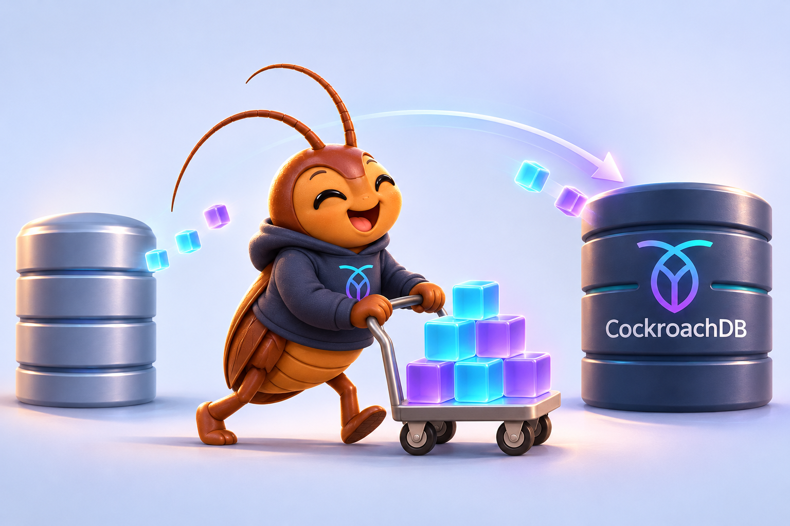

# Molt UI


A web interface for `molt`, the database migration tool for CockroachDB.
Configure migrations, follow progress, and inspect results in your browser.

## Features

- Run Molt commands through a web app.
- Configure commands with a guided, tabbed wizard.
- View live logs with per-table statistics and status.
- View live charts based on Molt's Grafana dashboard, with schema, table,
  and shard filters.
- Search and filter logs by level and stream in the Output tab.
- Save job history locally in SQLite.
- Review past jobs and reconstruct their table summaries.
- Re-run saved commands with editable settings.
- Import existing log files for review.
- Automatically update available options when Molt changes.

## Get started

### Install

You'll need **Python 3.14+**, **[pipx](https://pipx.pypa.io/stable/how-to/install-pipx.html)**,
**Git**, and the **`molt` executable**.

Install Molt UI directly from GitHub:

```sh
pipx install --python python3.14 git+https://github.com/fabiog1901/molt-ui.git
pipx ensurepath
```

Open a new terminal after `pipx ensurepath`. pipx installs the app in an isolated
environment and makes `molt-web` available on your `PATH`.

Make the Go `molt` executable available on your `PATH`, or set its absolute path:

```sh
export MOLT_EXECUTABLE=/absolute/path/to/molt
```

### Start the web app

Start the web app from your terminal:

```sh
molt-web
```

Open <http://127.0.0.1:8000>. Select **Configure command** to choose an operation,
enter your connections, and review the command before clicking **Run**.

Choose a listen address and port with `molt-web --host 127.0.0.1 --port 8080`.
Use `molt-web --reload` to restart the server when source files change during development.
Additional Uvicorn options can be passed as `--key=value` or `--key value`, for
example `molt-web --log-level=debug`. Hyphens in option names become underscores;
additional values are forwarded as strings.
Run `molt-web --help` to see available options. From a source checkout, you can
also use `python -m molt_ui.main`. The FastAPI app is available at
`molt_ui.api.app:app` for direct use with Uvicorn.

## Table progress

Select **Table progress** to follow exported and imported row counts, errors,
warnings, and status for each table. Filter by table name and expand a table to
inspect its recent log entries. Totals include the full received log, even when
older lines have left the live output buffer.

Select **Output**, beside **Command details**, **Table progress**, and **Charts**, to
inspect logs. Search messages and structured fields, filter by minimum log level
and stream, switch to raw JSON, or pause following the latest lines. Reset filters
to see all loaded lines. For saved runs, filters apply to the loaded page; use
**Older page** and **Latest page** at the bottom to browse the rest.

## Charts

Select **Charts** beside **Table progress** to view fetch or verify metrics over
time. Fetch charts show exported and imported rows, row rates, and latency
percentiles. Verify charts show rows read and row verification statuses. Use the
schema, table, and shard filters to narrow the displayed series.

The app collects Molt's Prometheus endpoint every two seconds, even when the
Charts view is closed, and saves the latest 1,800 samples (about 1 hour) per
job in SQLite. Saved jobs retain their charts across app restarts. Imported logs
and jobs run before metrics collection was added have no metric samples.

Rates use a 1-minute window; p50/p75/p90/p99 latency percentiles use 5 minutes.
Both are estimates from collected samples, rather than exact PromQL results.
Missing metrics remain empty, and some charts only apply to particular migration
modes. Collection is capped at 2,000 raw series, and each chart displays up to 24
series at once; use filters to narrow larger inventories.

No Prometheus or Grafana server is required. The app uses the configured
`--metrics-listen-addr` (default `127.0.0.1:3030`), mapping wildcard listeners to
loopback when scraping. It defaults `--metrics-scrape-interval` to `2s` so Molt
keeps its final metrics available before exiting; an explicit value takes
precedence. Configure these options in the command wizard's **Metrics** tab.

## Run summary

Select the **Command details** tab to see the **Run summary**. This tab opens
by default when you select a history item and shows:
status, start and finish times, exit code, and available duration, table, and
error metrics. Fetch runs also include a table breakdown of total, export, and
import timings and data errors. These values describe the run as a whole and
stay independent of chart filters.

Expand **Invocation and log file** inside the summary to inspect or copy the
command and see the saved log path, when available.

## History

Use the history sidebar to review saved runs, logs, table summaries, and charts.
Select **Re-run command** to restore a run's settings in the wizard, edit them,
and review the command before starting a new job. Remove individual records or
clear the saved history from the sidebar.

Jobs that exit unsuccessfully are marked **failed**, with their exit code and
latest error diagnostic saved in history. On startup, unfinished jobs whose app
process is no longer running are marked **interrupted**, with an unknown outcome.
Recovery checks local process ownership on POSIX systems; jobs owned by another
host or an owner that cannot be checked are left unchanged.

Job history and metric samples are saved in `.data/molt-ui.sqlite3` under the
directory where you launch the app. Set `MOLT_DATABASE` to an absolute path to
share the same history across launches from different directories.

Start from scratch with `molt-web --drop-db`. This deletes the configured
SQLite database, including saved history, metrics, and command catalog. Startup
recreates the database at the same path using the current schema and refreshes
the command catalog. Deletion happens once before the server starts, so
`--reload` restarts retain data created during that session.

Run IDs keep Molt's raw UTC timestamp, such as `2026-11-12T17.50.58Z`, and the
interface displays it as `2026-11-12 17:50:58`. Runs without a timestamped
filename use their start time. Duplicate timestamps are rejected rather than
assigned a suffix.
Older database schemas are not automatically upgraded; use `--drop-db` to reset
the database when switching from an older schema, or choose a fresh
`MOLT_DATABASE` path to preserve the old database.

## Review logs

Select **Review logs** in the web app to import an existing log file. For a quick
tour without running a migration, select **Review logs → Load sample log**.
Imported logs use the same table statistics and output views as live runs.

## Command catalog

On first launch, the app reads Molt's commands and stores their catalog in SQLite.
It refreshes the catalog when the Molt version changes, keeping available command
options in sync with the executable.

---


