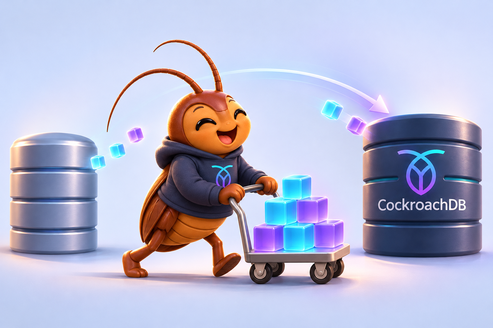

# Molt UI


A web and terminal interface for `molt`, the database migration tool for
CockroachDB. Configure migrations, follow progress, and inspect results from the
interface that suits your workflow.

## What you can do

- **Configure commands with guidance.** Run fetch, verification, and schema
  conversion with a wizard that shows relevant options for your source database.
- **See progress clearly.** Follow live output alongside table-level row counts,
  errors, warnings, and skipped tables.
- **Keep a record.** Review the exact command before running it and revisit saved
  commands and results afterward.
- **Explore existing logs.** Import a saved log or load the included sample to
  try the interface without running a migration.

## Get started

You'll need **Python 3.14+**, **[pipx](https://pipx.pypa.io/stable/how-to/install-pipx.html)**,
and the **`molt` executable**.

From this checkout's project directory, install Molt UI:

```sh
pipx install --python python3.14 .
pipx ensurepath
```

Open a new terminal after `pipx ensurepath`. pipx installs the app in an isolated
environment and makes both `molt-web` and `molt-tui` available on your `PATH`.

Make the Go `molt` executable available on your `PATH`, or set its absolute path:

```sh
export MOLT_EXECUTABLE=/absolute/path/to/molt
```

Start the web app from your terminal:

```sh
molt-web
```

Open <http://127.0.0.1:8000>. Select **Configure command** to choose an operation,
enter your connections, and review the command before clicking **Run**. For a
quick tour without running a migration, select **Review logs → Load sample log**.

To use the terminal interface instead:

```sh
molt-tui
```

You can also open a saved log directly:

```sh
molt-tui --log /path/to/fetch.jsonl
```

On first launch, the app reads Molt's commands and stores their catalog in SQLite;
it refreshes the catalog when the Molt version changes. Job history is saved in
`.data/molt-ui.sqlite3` under the directory where you launch the app. Set
`MOLT_DATABASE` to an absolute path to share the same history across launches
from different directories.

---


